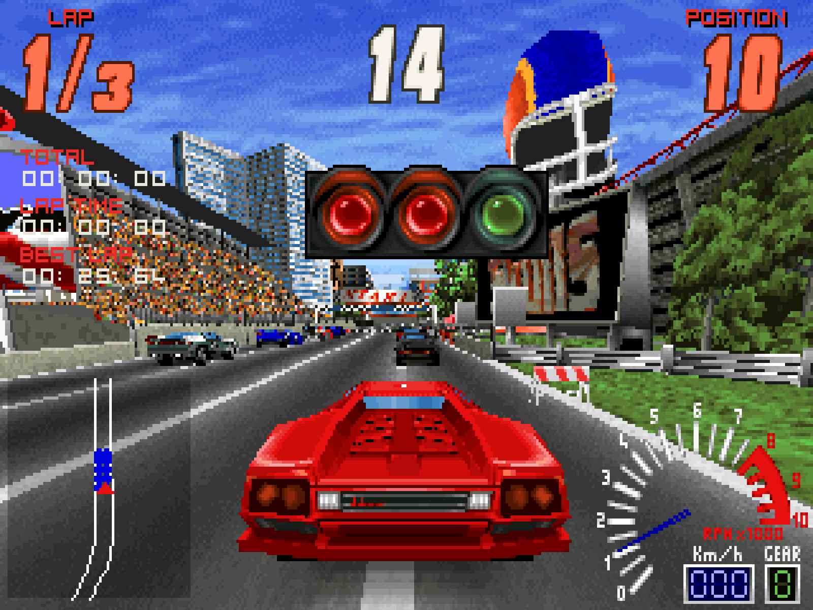

# Screamer for the Analogue Pocket

An [openFPGA](https://www.analogue.co/developer) core that runs *Screamer* (Graffiti / Virgin
Interactive, 1995, MS-DOS) on the Analogue Pocket.

The game's logic runs as C firmware on a RISC-V soft core (VexRiscv, 74.25 MHz), and the 3D
work is done by dedicated hardware units: geometry, triangle setup, rasterizer, blitter and an
audio mixer. The core reads the **unchanged original game files** from the SD card. No game
data is part of this repository or of its releases.



You can find a video of the core running on YouTube:

https://youtu.be/lczQRB2F0cM

## Features

- All six tracks, all cars, the opponents' cars, props and moving scenery
- Normal race, championship, time attack with ghost, cone carnage and slalom
- Replays with the game's trackside cameras, the pause screen with its working CD player
- The game's menus, options, records and name entry, saved between sessions
- Music from the game's CD image, or, without it, the MIDI songs through an FM chip (OPL2, the
  AdLib sound of the original); sound effects and speech
- 50 frames per second at the Pocket's native 320 x 200 picture, perspective-correct textures
- A longer view than the original's (2.0 times the distance), with the level of detail of the game's
  meshes stretched to match (1.2 times). Both factors can be changed in an optional file, `screamer.cfg`
  (see *Settings*)
- Pocket integration: Core Controls remapping, analog sticks and triggers in the dock

Not supported: network play (the menu entry is left out), the link port.

## Installation

1. Install the core with the Pocket Updater (recommended), or unzip the release archive into
   the root of the SD card.
2. Copy the game's files to `Assets/screamer/common/` on the SD card. For the GOG version, see
   below.
3. Start *Screamer* from the Pocket's core list. You find it in the group *Computer*.

The core has been tested only with the GOG release of the game. Other releases might work if their
files are the same.

### GOG version

Copy the following folders and files from the game's install folder to
`Assets/screamer/common/` on the SD card, as they are:

| Copy | What it is |
|---|---|
| `./GFX/` | The graphics: textures, track pictures, menus, the cockpit and the dashboard. |
| `./DATA/` | The game's data: track data, texts, sound effects, and the MIDI songs (`MUSIC.DAT`) that the original played through an AdLib card when it found no CD. |
| `./SCREAM.gog` | The CD image with the game's music. |
| `./SCREAM.DAT` | The cue sheet of the CD image. |

### Settings

An optional text file `screamer.cfg` in `Assets/screamer/common/` changes how far the core draws. `far` and
`lod` are factors on the original's distances (1.0 is the original's picture). Without the file the core
uses these values:

```
far = 2.0
lod = 1.2
```

`far` is the view distance. `lod` is the distance at which things switch to a coarser mesh (`lod = off` turns
that off). Larger numbers show more, and farther away, but take more time per frame. `#` starts a
comment. A line the core does not understand is ignored.

Saves and the debug log go to `Saves/screamer/Chainy.Screamer/`. `debug.txt` helps when something goes
wrong. The Pocket writes it when the core is quit.

## Controls

The defaults can be changed in the Pocket menu under *Core Controls*.

| Action | Button |
|---|---|
| Accelerate / OK | B |
| Brake | Y |
| Change camera | X |
| Back | A |
| Gear up / down | R / L |
| Pause | Start |
| Quit race | Select |

## Building

Quartus Prime Lite 18.1 and the firmware toolchain run in Docker, so you need Docker, a shell
and Python 3. From the repository root:

```sh
tools/fw.sh          # firmware: build/firmware/firmware.bin, program.bin
tools/build.sh       # bitstream: core/output/bitstream.rbf_r
tools/package.sh     # the SD card layout in build/sdcard/
tools/deploy.sh /i   # package and copy to the SD card at /i, with your game files
```

## Credits

- [OpenScreamer](https://github.com/ItsDanik/openscreamer) (GPL-3.0): the reference for the
  game's logic and file formats
- [VexRiscv](https://github.com/SpinalHDL/VexRiscv) (MIT): the CPU
- Analogue's [core template](https://github.com/open-fpga/core-template): `core/src/fpga/apf/`
  and the JSON templates in `core/`
- [font8x8](https://github.com/dhepper/font8x8) (public domain): the firmware's test font

*Screamer* belongs to its respective owners. This project is not affiliated with them or
with Analogue.

## License

GPL-3.0, see [LICENSE](LICENSE).
