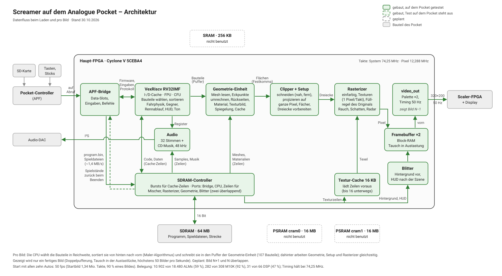

# Architektur

Stand: 2026-10-25. Gebaut und auf dem Pocket getestet: Video-Ausgabe 320×200 aus zwei
8-Bit-Framebuffern im Block-RAM, je mit eigener Palette, getauscht in der Austastlücke, und
die CPU (VexRiscv RV32IMF mit FPU und CFU, `docs/soc.md`), die in Schritt 1 selbst in die
Framebuffer zeichnet und ein Protokoll auf die SD-Karte schreibt. Belegung: 3.679 ALMs,
176 M10K, 11 DSP-Blöcke. Davor lief der Framebuffer im PSRAM `cram1` (Commit `b148783`).
Alles Weitere sind Schätzungen, bis die Synthese echte Zahlen liefert.

## Hardware des Pocket (Haupt-FPGA)

Cyclone V 5CEBA4F23C8: 18.480 ALMs, 308 M10K (je 10 Kbit), 66 DSP-Blöcke, 4 PLLs.
Getrennte Speicherbusse: SDRAM 64 MB, PSRAM `cram0` und `cram1` je 16 MB, SRAM 256 KB
(alle 16 Bit breit).

## Aufteilung

Wie der Rasterizer ein Dreieck in Pixel zerlegt und wie der Texturpfad als Fließband geplant ist: [rasterizer.svg](rasterizer.svg).

Grün: gebaut und auf dem Pocket getestet. Grau gestrichelt: geplant. Drei Bilder sind
gleichzeitig in Arbeit: Die CPU berechnet Bild N+1 und schreibt dessen nach Abstand
sortierte Objektliste ins SRAM, die Geometrie-Einheit liest die Liste von Bild N und
liefert Dreiecke an den Rasterizer, der Texel über seinen Textur-Cache aus dem SDRAM liest und Bild N in den
hinteren Framebuffer zeichnet, während `video_out` den vorderen zeigt (Bild N−1).
Getauscht wird in der Austastlücke; Befehlslisten und Framebuffer sind doppelt gepuffert.

| Speicher | Inhalt |
|---|---|
| SDRAM | Programm, Geometrie, Spielzustand, Texturen der aktuellen Strecke (`MAPn.MLB`, ≤ 3 MB, über den 16-KB-Textur-Cache) |
| SRAM | Befehlslisten der Geometrie-Einheit, doppelt gepuffert (je ≤ 26 KB), Rest Reserve |
| cram0 | Soundeffekte (`SOUND.DAT`, 1,9 MB): gleichmäßig und langsam gelesen, der Mischer stört so nie die Zugriffe von CPU und Rasterizer aufs SDRAM |
| cram1 | frei |

Eine Cache-Zeile Texturen kostet aus dem SDRAM etwa 25 Takte, aus dem PSRAM (asynchron)
etwa 130. Die Texturen bleiben deshalb im SDRAM, solange CPU und Rasterizer sich dort nicht
messbar ausbremsen; sonst ziehen sie in einen eigenen PSRAM um.
| Block-RAM | zwei Framebuffer (2 × 64 KB) und zwei Paletten, Boot-RAM, CPU-Caches, Textur-Cache, Transparenztabelle (`MAPn.SMG`) |

## Speicherbedarf eines Rennens (gemessen, entpackt)

| Daten | Datei | Größe |
|---|---|---|
| Texturen | `GFX/MAPnL/H.DAT` → `MAPn.MLB` | 2,3–2,9 MB |
| Streckengeometrie | `MAPn.UNR` | 0,6–1,6 MB |
| Autos, Requisiten | `*.3DX` | ca. 270 KB |
| Kartenraster | `MAPn.MMP` | 100–240 KB |
| Himmel | `MAPn.BCK` | ca. 70 KB |
| Fahrlinien, KI, Kameras | `DATA/MAPn.DAT` | 17–41 KB |
| HUD, Cockpit | `GFX/GAME.DAT` | 2,3 MB (L- und H-Satz) |
| Effekte (8-Bit-PCM) | `DATA/SOUND.DAT` | 1,9 MB |
| Tabellen | `TABS/*.TAB` | ca. 410 KB |

## Spieldaten auf der SD-Karte

Die originalen Dateien, unverändert und flach in `Assets/screamer/common/` (die Namen sind
über `DATA`, `GFX` und `TABS` hinweg eindeutig). Je Datei ein Data-Slot mit `deferload`:
der Core liest das Inhaltsverzeichnis am Dateiende und holt sich die Einträge, die er
braucht. 33 Dateien, eine mehr als die 32 Slots: offen, z. B. zwei Dateien in einem Slot.

- `DATA/`: alle 16 (`GEN`, `LOCAL`, `MUSIC`, `SOUND`, `MAP1`–`MAP6`, `MAP1I`–`MAP6I`)
- `GFX/`: `GAME`, `GRAF`, `MENU`, `MAP1L`–`MAP6L`, `MAP1H`–`MAP6H` (L und H sind die Sätze der
  Option DETAIL: L bei LOW, H ab MID; nicht die Auflösung)
- `TABS/`: `PERSP01.TAB`, `VIS.TAB`

## Geschätzte Belegung

Die Grafik erzeugt `tools/make_budget_svg.py` aus denselben Zahlen wie diese Tabelle; wenn
die Synthese eine Schätzung ersetzt, beides anpassen.

| Komponente | ALMs | M10K | DSP |
|---|---|---|---|
| Analogue-Rahmen (**gemessen**, unverändertes Template) | 414 | 2 | 0 |
| Framebuffer ×2 + Video (**gemessen**: `framebuffer`, `video_out`, `fb_bridge`) | 78 | 130 | 0 |
| VexRiscv RV32IM + 2× 8 KB Cache (einzeln synthetisiert: 1.268–1.278) | 1.250–1.300 | 19 | 4 |
| FPU (RV32F, einzeln synthetisiert: ~1.780) | 1.750–1.800 | 5 | 4 |
| CFU (eigene Befehle, z. B. 16.16-Multiplikation) | 30–100 | – | 3 |
| Boot-RAM 4–16 KB (Startcode, Speichertest) | 20–50 | 4–16 | – |
| Speicher-Controller (SDRAM, `cram0`) + Arbiter | 900–1.400 | 2–4 | 0 |
| SRAM-Controller (Befehlslisten) | 100–200 | – | 0 |
| Geometrie-Einheit | 2.500–4.000 | 4–8 | 12–18 |
| Rasterizer (Logik) | 2.000–3.000 | 3–6 | 4–8 |
| Textur-Cache 16 KB | 100–200 | 16 | – |
| Transparenztabelle (`MAPn.SMG`, 64 × 256 Byte) | – | 16 | – |
| JTOPL | 800–1.200 | 3–5 | 0–1 |
| PCM-Mixer | 300–500 | 2 | 1–2 |
| **Summe** | **10.242–14.242 (55–77 %)** | **206–229 (67–74 %)** | **28–40 (42–61 %)** |

Knapp wird die Logik: ab etwa 80 % Belegung wird es auf dem Cyclone V schwer, die
Taktfrequenz zu halten. Block-RAM trägt die beiden Framebuffer (128 M10K); CPU-Caches und
Textur-Cache teilen sich den Rest und werden später an Messungen ausgerichtet. Einen
Tiefenpuffer gibt es nicht, siehe „Entschieden“.

VexRiscv und FPU stammen aus einer Synthese der CPU allein für den 5CEBA4F23C8 mit Quartus
18.1.1 (Recherche 2026-10-25): RV32IM mit 2 × 8 KB Cache 1.268–1.278 ALMs, 19 M10K, 4 DSP,
Fmax um 115 MHz; mit FPU 3.052–3.061 ALMs, 24 M10K, 8 DSP, Fmax 98–111 MHz (Median 105).
Die FPU macht Float-Rechnungen 13–32 × schneller als Soft-Float.

## Entschieden

- **Sprache:** eigener Code in Verilog (wie das Template). Der VexRiscv wird einmalig aus
  einer Scala-Konfiguration als Verilog erzeugt, eigene CPU-Befehle laufen über sein
  CFU-Plugin. Gleiche Leistung wie SpinalHDL, leichter zu lesen.
- **Spieldaten:** Originaldateien flach in `Assets/screamer/common/` (siehe oben).
- **50 Hz, ein Spielschritt pro Bild:** Das Original hat keinen festen Takt, seine Physik
  rechnet mit der gemessenen Bildzeit, begrenzt auf 0,02–0,2 s; schneller als 50 Schritte
  pro Sekunde wird es also nie (OpenScreamer `docs/NOTES.md`, Fahrmodell). Die Bildausgabe
  läuft deshalb mit genau 50 Hz (480 × 512 Takte bei 12,288 MHz, der Bildschirm des Pocket
  kann 47–61 Hz), und jedes Bild ist ein Physikschritt mit 20 ms: das Spiel bei seiner
  besten Rate, ohne Zwischenbilder und ohne Ruckeln. Die Uhr für Countdowns und
  Rundenzeiten tickt im Original mit 100 Hz und bekommt ein eigenes Zählregister. Pro Bild
  stehen 1,485 Millionen Takte zur Verfügung.
- **VGA-Fassung:** 320×200 mit 8-Bit-Palette wie die VGA-Version des Spiels. Die Strecken
  kommen trotzdem aus beiden Sätzen: `MAPnL` bei DETAIL LOW, `MAPnH` ab MID (STARTL.EXE wie
  STARTH.EXE, OpenScreamer `docs/NOTES.md` Abschnitt 27). Wie weit gezeichnet wird, legt DETAIL
  fest wie im Original: Teile bis 52000 Einheiten, Flächen geschnitten in der Tiefe 27808
  (LOW, MID) oder 43808 (HI). Cockpit, Renninfos und andere statische Bilder sind Sprites aus dem L-Satz von
  `GAME.DAT` und kommen 1:1 pixelgenau in den Framebuffer: erst von der CPU gezeichnet,
  später über einen Sprite-Modus des Rasterizers (Rechteck unverzerrt kopieren, eine Farbe
  durchsichtig).
- **Sichtbarkeit wie im Original, ohne Tiefenpuffer** (Maler-Algorithmus): Die CPU
  sortiert ganze Objekte nach dem Abstand ihres Mittelpunkts von der Kamera und gibt sie
  von hinten nach vorn aus (im Original `0x83164`: `dist² >> 2`). Innerhalb eines Objekts
  liegt die Reihenfolge in den Daten: Jeder Mesh-Block hat acht vorberechnete
  Flächenlisten, eine je Oktant der Blickrichtung, ohne die von dort unsichtbaren Flächen
  (Header +0x28..+0x44, OpenScreamer `docs/NOTES.md`). Die Geometrie-Einheit wählt die
  Liste über die drei Vorzeichen der Blickrichtung im Objektraum; sie sortiert nicht und
  braucht keinen Rückseitentest. Die Streckendaten verlassen sich auf diese Reihenfolge
  (Grasflächen unter der Straße, zwei Objekte an einer Stelle), OpenScreamer brauchte
  dafür mit seinem Tiefenpuffer Sonderregeln. Nötig bleibt das Clipping an der vorderen
  Ebene. Es spart rund 125 M10K (320×200×16 Bit passen nur in die 8-Kbit-Modi); dafür
  wird jedes verdeckte Pixel erneut geschrieben, was die Bandbreite zum Framebuffer
  wichtiger macht.
- **Erst die Setup-Einheit, dann der Rest der Geometrie:** Der Durchflug durch Strecke 1
  hat die Geometrie auf der CPU vermessen: rund 3000 Takte je Dreieck, fast die Hälfte
  davon die Vorbereitung je Dreieck (die Ebenen von Q, U, V mit Divisionen), ein Viertel
  Zuschneiden und Projektion, das Umrechnen der Eckpunkte nur 3 %. Deshalb kam zuerst die
  Setup-Einheit (`setup.v`, C-Modell `firmware/setup.c`): Die CPU gibt Vielecke in
  Kamerasicht ab (fünf Floats je Ecke), die Hardware projiziert, zerlegt sie in einen
  Fächer und rechnet die Werte für den Rasterizer in Festkomma, während der Rasterizer das
  vorige Dreieck zeichnet. Danach das Zuschneiden (`clipper.v`, davor): mit der
  Setup-Einheit sank die CPU-Zeit im schwersten Bild von 10,4 auf 5,8 Mio. Takte, davon
  58 % Zuschneiden. Wie im Original an der nahen Ebene (Tiefe 128) und der fernen der
  DETAIL-Stufe; dazu ein Schutzband bei 14 × Tiefe, nur damit die Bildschirmkoordinaten in
  16 Bit passen (den Bildrand schneidet der Rasterizer). Das Objektiv ist das des
  Originals: Brennweite 128, Augenhöhe bei 65 % der Bildhöhe. Danach blieben der CPU
  1,5–2,7 Mio. Takte je Bild, vor allem Flächenlisten und das Schreiben der Ecken. Die
  Geometrie-Einheit (`geom.v`, C-Modell `firmware/geom.c`) nimmt ihr das ab: Die CPU wählt
  die Bauteile aus, sortiert sie und schreibt je Bauteil 18 Wörter (Matrix, Ursprung,
  Auge, Mesh, Flächenliste) in den Puffer der Einheit (113 Bauteile, Block-RAM); die
  Einheit liest das Mesh selbst aus dem SDRAM, rechnet die Eckpunkte um, lässt Rückseiten
  weg, schlägt die Materialien nach und gibt die Flächen an den Clipper. Mit ihr hält der
  Durchflug meist 50 fps, die CPU braucht etwa 20 % eines Bildes; durch den Puffer wartet
  sie nicht mehr auf jedes Bauteil, die Zeit bleibt für Autos und Spiellogik.
- **Bilder überlappen (Pipeline):** CPU, Grafik und Anzeige arbeiten gleichzeitig an Bild
  N+1, N und N−1, die Zeit pro Bild ist das Maximum statt der Summe. Kosten: ein Bild mehr
  Verzögerung zwischen Eingabe und Anzeige (20 ms bei 50 fps).
- **Zwei Framebuffer im Block-RAM** statt im PSRAM: Der Rasterizer schreibt den hinteren
  mit einem Pixel pro Takt, Übermalen kostet nichts, und es braucht weder PSRAM-Controller
  noch Arbitrierung für den Framebuffer (spart Logik, die knappe Ressource). Jeder Puffer
  hat seine eigene Palette, Palettenwechsel (Überblendungen) passen damit genau zum Bild.
  Die Zeichenseite liest auch (Rauch, Glas, Schatten und Radar verrechnen den Bildinhalt):
  vier explizite 8-Bit-Speicherbahnen mit Lese-/Schreibport (`fb_lane.v`), weil Quartus
  18.1 den Speicher mit echten Byte-Enables sonst stillschweigend aus Registern baut;
  `tools/check_budget.py` prüft bei jedem Build die 128 M10K. Getauscht wird am Anfang
  jeder Zeile der Austastlücke, höchstens einmal je Lücke (`video_out.v`): Ein Bild, das
  etwas länger als 20 ms braucht, fällt so nicht gleich auf 25 fps. Unabhängig
  gegengeprüft gegen SRAM, PSRAM und Mischformen (2026-10-25).
- **SRAM für die Befehlslisten:** AS6C2016-55, 55 ns, laut Analogue kaum schneller als der
  PSRAM und ohne Bursts, also nichts für Pixel. Für die doppelt gepufferten Objektlisten
  (je ≤ 26 KB, ~10 % der SRAM-Zeit) reicht es gut, und die Geometrie-Einheit liest sie
  über einen eigenen Bus, ohne die CPU im SDRAM zu stören. Den Listenzugriff so bauen,
  dass die Listen in den SDRAM umziehen können, falls die Logik knapp wird.
- **Perspektivkorrektur exakt pro Pixel:** Eine Kehrwert-Einheit (Tabelle und ein
  Newton-Schritt, 2–3 DSP) liefert einen Kehrwert pro Takt, also kostet es keine Zeit. Der
  Software-Renderer von OpenScreamer rechnet nur jedes achte Pixel exakt, daher seine Knicke
  in nahen Texturen. Die Festkomma-Bitbreiten werden am C-Modell gegen Fließkomma bestimmt.

## Übergabe zwischen den Bildern (Vorgaben für CPU und Grafik)

Aus der Gegenprüfung der Framebuffer-Platzierung:

- Der Tausch wird erst angefordert, wenn der letzte Pixel des Bildes geschrieben ist:
  Ein Ende-Zeichen läuft durch die ganze Grafik-Pipeline, erst danach kippt
  `swap_req_toggle`.
- Palettenwechsel stehen in der Befehlsliste von Bild N und werden beim Beginn von Bild N
  in die Palette des hinteren Puffers geschrieben. Die CPU schreibt die Palette nie direkt,
  denn sie ist schon ein Bild weiter.
- Der Zeichner kennt seinen hinteren Puffer aus seinem eigenen Toggle (hinten = nicht
  `req`) und wartet nur auf die Quittung; er liest `front` nicht über die Taktdomäne.
- Ein Reset darf keinen Tausch vortäuschen: Er setzt Anforderung und Quittung auf 0, danach
  ist Puffer 0 vorn, bis der Zeichner tauscht (in `sim/display` und `sim/soc` geprüft).

## Offene Entscheidungen

- **Zahlenformate:** Rasterizer und Geometrie in Festkomma (Bildschirmkoordinaten mit
  mindestens 4 Nachkomma-Bits), die Physik auf der CPU in `float` wie im Original.

## Vorgehen

1. Grundgerüst: Template, zwei Framebuffer mit Palette, Eingabe (erledigt, auf dem Pocket
   getestet); JTOPL fehlt noch.
2. VexRiscv mit FPU und SDRAM. Das erste Programm ist ein Speichertest: SDRAM, SRAM und
   PSRAM mit Mustern beschreiben, zurücklesen, Ergebnis auf dem Bildschirm. Damit werden
   die externen Speicher geprüft, bevor etwas auf sie baut (das SRAM erst hier, nicht
   vorher einzeln). Danach die Spiellogik von OpenScreamer bare-metal, erst mit
   Software-Renderer.
3. Bitgenaue C-Modelle von Rasterizer und Geometrie-Einheit, dann die Hardware dazu,
   jeweils in Verilator gegen das Modell geprüft.
